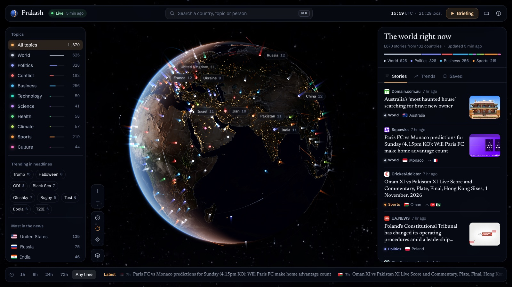
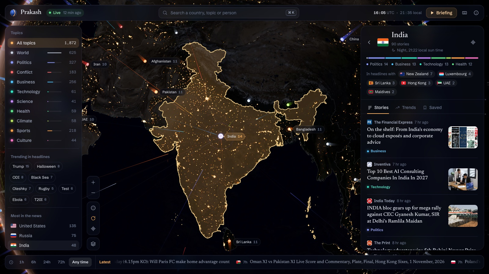

# Prakash

Prakash puts the day's news on a 3D globe. You spin the Earth, click a country, and read what its newsrooms are reporting. It pulls headlines from about 180 countries and refreshes every half hour.

Live: https://aniketmaithani.net/prakash/



## Where this came from

This is a redesign of [NewsGlobe](https://newsglobe.saurabhn.com/) by Saurabh Nandedkar ([@EXTREMOPHILARUM](https://github.com/EXTREMOPHILARUM)). He had the idea and built the original. I liked it enough to want a version with a more realistic Earth and a few more ways to read the news, so I rebuilt the front end from scratch. None of his code is in here, but the concept is his, and you should go look at his version too.

"Prakash" means light in Hindi. City lights on the night side, a light pillar for every country: the name seemed to fit.

## What you can do with it

Drag to turn the globe and scroll to zoom. Each country has a pillar, and its height shows how much it's in the news. That counts its own stories plus the times other countries' headlines mention it. When two countries show up in the same headline, an arc connects them.

Click a country and the camera flies there, framed to its size. The side panel switches to that country's stories, the topic mix, the local time of day and the countries it's been in the news with.

Some other things I added:

- Search that drops results on the map where the story is happening
- A briefing mode that flies east to west through the top story in the twelve busiest countries
- A trends tab with recurring names, stories per hour and the busiest outlets
- A reading list, kept in your browser
- Topic and time filters, plus a scrolling ticker
- A command palette on ⌘K (Ctrl+K on Windows) and keyboard shortcuts for most things. Press `?` for the list.
- Links you can share, like `#country=KE` or `#q=elections`
- A bottom sheet on phones in place of the side panels

The Earth is drawn with custom WebGL shaders on top of three.js. Daylight follows the sun's actual position right now, so the dark side really is where it's night. Clouds cast shadows and the oceans catch the sun.



## Running it locally

You need Node 18 or newer.

```bash
npm install
npm run dev
```

Open http://localhost:5173. The dev server also runs a small news API, so there's nothing else to start. The first run takes around 15 seconds while it fetches every country. After that it keeps a copy in `.cache/`, so restarts are quick.

To run a production build with the same live API:

```bash
npm run build
npm start        # http://localhost:4173, or set PORT
```

## How the GitHub Pages version works

Pages only serves static files, so there's no server to fetch news on demand. Instead, `.github/workflows/pages.yml` runs every 30 minutes. It builds the site, runs `scripts/snapshot.mjs` to fetch headlines and saves them as JSON next to the app, then deploys. The 30 countries getting the most attention also get a fuller set of stories.

The static build differs from the local one in two ways:

- Search only looks through the stories already loaded, since it can't query Bing live.
- Countries outside that top 30 show the stories from the main sweep, usually 10 to 15.

GitHub turns off scheduled workflows on a repo with no activity for 60 days. If the news stops updating, re-enable the workflow from the Actions tab.

To host your own copy, fork the repo, go to Settings → Pages, set the source to "GitHub Actions", and run the workflow once.

## Credits

- Headlines come from Bing News RSS. Every story links to the original publisher.
- Topics are guessed from keywords in the headline, so a few land in the wrong bucket.
- Earth textures are from [Solar System Scope](https://www.solarsystemscope.com/textures/) (CC BY 4.0, based on NASA imagery). The relief and water masks come from the three-globe examples.
- Country borders are from Natural Earth, via `world-atlas`. Flags are from flagcdn.com, and outlet icons are Google's favicon service.
- Original idea and design: [NewsGlobe](https://newsglobe.saurabhn.com/) by Saurabh Nandedkar ([@EXTREMOPHILARUM](https://github.com/EXTREMOPHILARUM)).

`scripts/build-countries.mjs` regenerates `src/data/countries.json`, which holds country names, centre points, search terms and the aliases used to spot mentions. Run it if you want to change how a country is searched or recognised.
